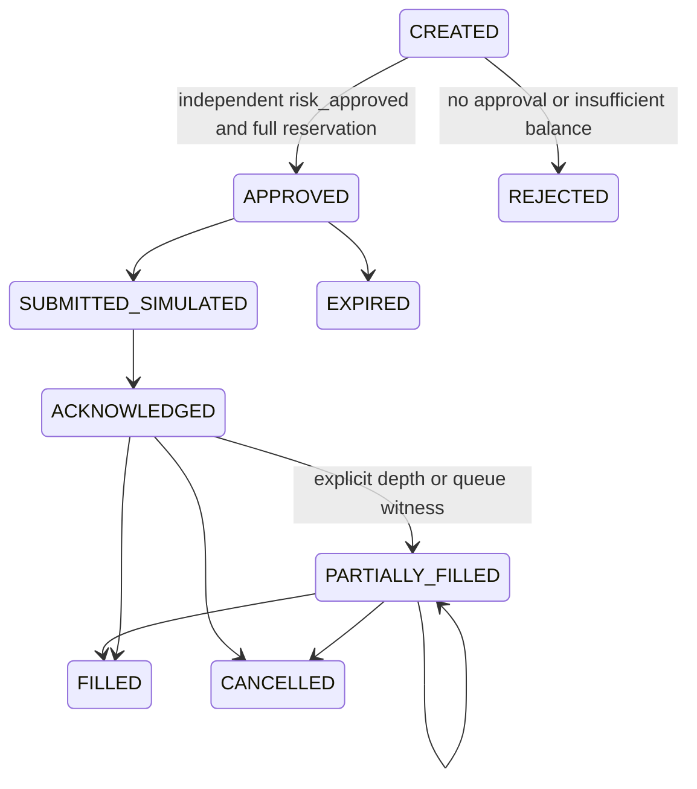

# Stateful course reconstruction: offline simulator, Grid and triangle

Status: `IMPLEMENTED / TESTED` for the named offline engineering invariants below. Scientific/economic status: `RESEARCH_CANDIDATE`; no profitability, historical fill or prospective evidence claim. Source attribution: the basic notebook examples are source concepts; everything in these modules involving reservations, lifecycle, graph/depth walks, failure paths, queue evidence, latency policy, persistence and arbitration contracts is `ENGINEERING_EXTENSION`.

## Scope and canonical integration

Files: `research_bot/course/simulation.py`, `research_bot/course/stateful.py`, `tests/test_course_stateful.py`, `research_bot/course/configs/course_stateful_v1.json`. These modules are within the canonical repository and introduce no network adapter, account authentication, exchange order operation, Risk Engine or evidence database. `OfflineOrderSimulator.mode` is `OFFLINE_REPLAY_NOT_PAPER`. A successful simulation cannot enable PAPER or LIVE. Production data and execution remain with their existing ports and guards.

`GridStrategyStateMachine.to_candidate()` and `ArbitrageOpportunityHypothesis.to_candidate()` adapt immutable plan hypotheses to `HypothesisCandidate.to_signal_evidence()` for the existing orchestrator, decision engine and ledger. Both keep confidence `None`; the canonical conversion emits `NO_TRADE`, with `UNESTIMATED_EDGE_OR_CONFIDENCE`. Grid expected edge is unknown. Direction is zero because a dependent multi-order spot plan is not a single directional order. The adapter describes research evidence, not execution authority.

Grid candidates carry whole-plan per-currency capital requirements, configuration hash, book hash, preregistered range reference and range evidence availability. Triangle candidates carry three snapshot hashes and capital in the initial currency. Their gross-to-buffer arithmetic is documented below. All identity hashes are deterministic; changes create a different hypothesis identity. Advanced logic does not modify the frozen v0.51 arbitration, predictors, admission thresholds, cost model, exits or existing risk limits.

## Shared simulated wallet and lifecycle

`SimOrderRequest` is immutable: order ID, explicit `MarketMetadata`, BUY/SELL, base quantity, MARKET/LIMIT, optional limit, fee rate/currency and latency. Prices, sizes, balances, notionals and fees use Decimal. Quantity must be an exact multiple of `step_size`; limit price must respect `tick_size`; minimum notional is checked before approval. IRT quotes require explicit TOMAN and IRR require RIAL via shared metadata. Fee support is intentionally limited to received/output currency or quote currency. Other conventions raise `UnsupportedCapability`; there is no guessed third-token commission conversion.

Lifecycle:



`risk_approved=True` is an explicit fixture/replay input, never independent proof of financial safety and never a live authorization token. The simulator enforces inventory/capital conservation as accounting; the existing canonical Risk Gate retains financial approval responsibility. Its same-order-ID/same-request operations are idempotent; changing request content under an existing ID is rejected. Terminal fills do not replay a second time.

BUY reserves quote at the limit or worst visible ask, including quote fees if selected. SELL reserves the base quantity. MARKET fills consume asks for BUY and bids for SELL. Each fill obeys the remaining reservation; moved prices beyond reserved capital cause a no-fill error rather than extra borrowing. Partial fills debit only actual input spent, credit only actual received output less output fee, release the filled fraction of escrow and retain escrow for the remainder. Cancellation/expiry release escrow. Negative balances and reservations are invalid. This worst-visible-price bound is conservative and can reject a depth-affordable order if worst-level reserve exceeds funds; it never promises fill at a midpoint.

For per-level executions `(p_j, q_j)`, base fill is `Q = sum(q_j)`, quote notional `N = sum(p_j*q_j)`, VWAP `N/Q`. BUY consumes `N`, receives `Q`; SELL consumes `Q`, receives `N`. Received-currency fee is `f*received`. A BUY quote fee consumes `N*(1+f)` instead. Fee tokens are recorded in their actual supported currency and never summed across currencies as an unlabelled monetary number.

Depth depletion keys venue, symbol, data version, exchange sequence and book side/level. Re-observing the same sequence with a later reception timestamp does not replenish liquidity. A revised source hash/level content under the same sequence is rejected. Fresh sequences are separate external observations, not proof of infinite refresh capacity. All four timestamps and freshness/sequence quality are validated before use. Snapshot prices off the tick are rejected.

LIMIT orders require explicit `queue_evidence_id` and actual externally evidenced `queue_fill_quantity`; OHLC touches and absent queue information cannot produce fills. Each witness is consumed once globally. The simulator accepts a supplied witness as an offline scenario input; it does not independently prove that witness exists at an exchange. Validated trade/queue provenance and partial-queue allocation require independent collection before using this mode scientifically. Maker fee is an explicit scenario assumption, not proof a resting order receives maker treatment in production.

Events receive caller-provided aware monotone timestamps and deterministic event IDs. Configured order latency blocks earlier fill attempts. `export_state()/from_state()` provide JSON-compatible hash-checked replay artifacts: wallet, reservations, requests, lifecycle events, depth depletion, book versions and used queue witnesses. Restoring verifies event hashes/time order, quantity bounds, terminal reservations and wallet invariants. These artifacts are local replay snapshots for linkage to the existing ledger, not another evidence ledger. They provide deterministic restart and accidental-change detection, not a cryptographic signature or an atomic external database protocol.

## Grid mathematics and plan governance

`GridConfig` requires a range preregistration reference; the example configuration intentionally leaves it null and keeps `enabled=false`. `prepare` requires point-in-time range evidence and explicit levels `(side_i, quantity_i, price_i)`. Initial inventory plus all BUY quantities is the conservative worst-case base inventory. It must not exceed the scenario's inventory capacity; SELL levels require pre-existing base inventory rather than depending on hypothetical future buys.

For quote-fee rate `f_m`, the whole plan reserves:

- quote capital `C_quote = sum_BUY(q_i*p_i*(1+f_m))`;
- base inventory `C_base = sum_SELL(q_i)`.

Every level is reserved in one transactional in-memory operation. If any reservation fails, the simulator checkpoint is restored and the plan becomes HALTED: no half-active grid remains. Orders are submitted only after all are RESERVED. Every order is a dependent member of the plan hash; duplicate levels are rejected. Current implementation uses explicit asymmetric quantities to represent inventory skew. It does not invent an adaptive re-centering model or optimize spacing.

Plan lifecycle is `INITIALIZED → READY → RESERVED → ACTIVE → PARTIALLY_FILLED → COMPLETED`, with cancellation/halt branches and explicit `REBALANCING` before cancelling an old plan for recentering. Acknowledgement alone cannot advance the grid to completion. If the preregistered range changes, data become invalid/stale or the observable spread leaves configured bounds, resting simulated orders are cancelled, escrow is released and residual filled inventory remains visible. Cancellation does not liquidate inventory or falsely erase its losses. Recenter means cancel first, then obtain new point-in-time range evidence and a new plan; no blind cancel-and-resubmit cycle exists.

The `max_inventory_base` is an offline capacity constraint, not replacement for canonical asset weight/CVaR/drawdown limits. Maker/taker scenarios are explicit: limit evidence fills use configured maker fee; taker rate is an input for separate unwind scenarios. No automatic inventory liquidation or capital governor is added. Existing orchestration must reject conflicts between grid, trend, arbitrage and other capital consumers before approving a research plan.

## Triangular graph, costs, partial legs and atomicity

Notebook 6 includes an educational route using ask USDT/IRT, ask BTC/USDT, bid BTC/IRT with a multiplicative fee factor; it does not establish actual execution, depth, fees charged per real currency or secured profit. The following graph and failure engine is `ENGINEERING_EXTENSION`.

Each market yields quote→base BUY on asks and base→quote SELL on bids. `discover_cycles` identifies three distinct currencies over three same-venue markets. `evaluate` requires an exact connected 3-leg cycle, valid snapshots, bounded snapshot skew, depth and minimum notional. It walks actual levels and floors each executable base quantity to market step. Unused input is preserved as residual inventory; it is not silently discarded or monetized at a midpoint.

For input `A`, BUY accumulates base quantity subject to `sum(p_j*q_j) <= A`; SELL accumulates quote notional subject to `sum(q_j) <= A`. At each leg `A_next = gross_output*(1-f_output)`. Fees are stored per output currency. Only this explicit commission convention is implemented; a venue using input, discounted-token or mixed fees requires documented extension first. The engine does not assert actual Bitpin fee conventions.

The executable-snapshot estimate is:

`P = final_leg_net_output + residual_initial_currency`

`B = initial_capital * risk_buffer_bps / 10000`

`expected_net_edge = P - initial_capital - B`.

Noninitial-currency dust is retained but excluded from proceeds. Spread and visible-depth impact are already included in `P`; output fees are deducted exactly once. The analytic estimate is not expected statistical profit and carries no calibrated confidence. In the canonical candidate, `expected_edge=(P-initial_capital)/initial_capital`, `expected_cost=0` because fees/depth are embedded, and `uncertainty=B/initial_capital`; therefore net utility deducts the configured buffer once. Additional canonical Risk Gate penalties may further reject it.

`AtomicityRiskAssessment.atomic=false` records unhedged currencies, snapshot skew, declared latency, buffer and explicit failure paths: rejection, partial fill, depletion, price change, unknown timeout, unwind loss and dust. Latency is an unverified scenario parameter. It is a minimum elapsed time between sequential leg resolutions; it is not a measured network distribution or simulation of future replenishment. A newer snapshot may reduce executable size. Freshness rules and scenario costs do not guarantee future liquidity.

`ArbitrageReplayPlan.execute_leg` recomputes quote size from the amount actually filled and received after commission, not the originally projected size. It submits through the offline simulator only. Rejected, non-full or depth-limited legs halt downstream; the filled amount and residual exposure remain in `plan_inventory()`. The request, acknowledgement, fill and halt are independent facts. There is no `Profit Secured` flag. The plan's inventory derives exclusively from its own order flows; unrelated strategies' wallet funds cannot inflate unwind proceeds.

`assess_unwind` calculates hypothetical direct conversion of owned residual currencies back to the original currency using supplied reverse books and fees, along with shortfall, residual/unvalued currencies and depth completeness. This assessment is not executed. Multi-step unwind or unavailable direct markets remain unvalued; no value is invented. A halted plan cannot restart its next leg automatically. `export_state()/from_state()` preserve hypothesis, shared simulator state, actual output, order IDs, events and failed-leg position for deterministic investigation.

## Acceptance tests and explicit limits

Executed locally on 2026-10-10:

```
PYTHONPATH=/tmp/course-test-tools:. python -m pytest -q tests/test_course_stateful.py
22 passed in 0.11s
PYTHONPATH=/tmp/course-test-tools python -m ruff check research_bot/course/simulation.py research_bot/course/stateful.py tests/test_course_stateful.py
All checks passed!
PYTHONPATH=/tmp/course-test-tools:. python -m mypy --follow-imports silent research_bot/course/simulation.py research_bot/course/stateful.py
Success: no issues found in 2 source files
```

The temporary tools directory is this workspace's test bootstrap; install the repository-declared developer tools for portable reproduction. Fixtures use synthetic books labelled `FIXTURE`, not Bitpin forward observations. Tests cover wallet/fee conservation, actual partial fills, depletion and repeated sequences, order collisions, insufficient balances, cancellation/expiry, queue witness idempotency, future/stale data, latency, invalid ticks/NaN/infinity, tampering and restart, whole-grid reservation rollback, breakout/regime/inventory rejection, three directional graph legs, snapshot skew, per-currency commissions, failed-leg unwind and exclusion of unrelated funds.

Engineering limitations: no exchange/API-order execution, no historical depth dataset, no queue provenance collector, no economic backtest/forward result, no dynamic liquidity model, no production persistence service, no automatic unwind, no native stop-limit/bulk exchange support, no confidence calibration or financial promotion. Unsupported order types are rejected explicitly. Default parameter values are example scenarios and remain unapproved. These gaps must not be hidden by passing deterministic unit tests. Independent portfolio/risk/arbitration checks and canonical evidence linkage are prerequisites for `INTEGRATED`, and prospective source/fill/cost evaluation is required for `EVIDENCE_VERIFIED`.

Rollback: disable course plan registration and revert only the five files listed at the top. Offline JSON artifacts may be retained as explicitly synthetic engineering evidence; frozen scientific files and execution flags remain unchanged.
