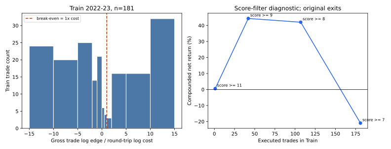

# فاز ۲.۰ — اقتصاد اجرا پیش از طراحی نسل دوم

تاریخ: ۲۰۲۶-۱۰-۱۵ UTC. این سند فقط روی بک‌تست موجود BTCUSDT M15 و بخش **Train: ۲۰۲۲-۰۱-۰۱ تا ۲۰۲۳-۱۲-۳۱** محاسبه شده است. قیمت یا بازده Test-1 و Test-2 خوانده نشده و هیچ کد استراتژی، سفارش، آستانه یا PR جدید ساخته نشده است. تحلیل سود و زیان فاز ۰ در [forensic_report.md](forensic_report.md) و پروتکل تقسیم داده در [phase2_protocol.md](phase2_protocol.md) است. این تحلیل تشخیصی و درون‌نمونه‌ای است.

## قرارداد هزینه و حسابداری

بک‌تست واقعی ۱۰ bps کارمزد **و ۵ bps اسلیپیج در هر سمت** دارد. پس ۲۹۹ رفت‌وبرگشت = ۵۹۸ سمت، هزینه اسمی رفت‌وبرگشت **۳۰ bps = ۰٫۳۰٪** و جمع هزینه اسمی `299 × 0.30% = 89.70%` notional است. عدد `74.75%` حاصل فرض جایگزین ۲۵ bps **برای کل رفت‌وبرگشت** است؛ با قرارداد source بک‌تست یکسان نیست. جمع bps بازده مرکب پرتفوی نیست: سرمایه بین معامله‌ها تغییر می‌کند. هزینه دقیق جمع‌پذیر در واحد log-return برای یک رفت‌وبرگشت `c = −2 log(1−0.0015) = 0.0030022523` یا `0.300225%` لگاریتمی است. بازده ناخالص ساده لازم برای سربه‌سر یک معامله `exp(c)−1 = 0.300676%` است. سناریوی ۲۵ bps نیز به‌عنوان حساسیت حفظ می‌شود، نه جایگزین داده اجرا.

برای بازتولید، آرشیو تأییدشدهٔ موجود با SHA256 Parquet `f7bf84ccaff343dbb627c17e6245ae6f2488f940a3ed6867efd262115ea9d401` و موقعیت‌های همان چهار evaluator استفاده شد. هر معامله از تغییر وضعیت flat→long در open پس از یک کندل کامل تأخیر آغاز و در open تغییر long→flat پایان می‌یابد. در انتهای Train، **یک معامله باز** با close آخرین کندل ۲۰۲۳ و هزینه خروج اجباری بسته شد؛ بنابراین قیمت ۲۰۲۴ برای ارزیابی Train استفاده نشده است. امتیاز `confluence` فقط از پنجره ۹۰ کندل بسته‌شده پیش از تصمیم ورود بازخوانی شد. تجزیهٔ log-return همه ۲۹۹ معامله دقیقاً بازده منتشرشده `+27.553713%` را بازتولید کرد؛ ۱۸۱ ورود در Train وجود دارد.

## A — نقطه سربه‌سر و بودجهٔ گردش

در ۲۹۹ معاملهٔ کل بک‌تست، جمع log-edge ناخالص `+1.141041` یا میانگین `0.381619%` به‌ازای معامله است. هزینه log برابر `−0.897673`، پس log بازده خالص `+0.243367` و بازده مرکب `+27.55%` شد. میانگین edge ناخالص فقط `1.271` برابر هزینه بود. اگر هزینه واقعاً ۲۵ bps کل رفت‌وبرگشت بود، ۲۹۹ معامله `74.75%` notional هزینه اسمی داشت؛ قرارداد ۳۰ bps واقعی `89.70%` دارد.

| تعداد معامله در افق سه‌ساله | هزینه اسمی ۲۵ bps | هزینه اسمی واقعی ۳۰ bps | هزینه دقیق log واقعی | بازده مرکب با **همان میانگین gross log-edge مشاهده‌شده** |
|---:|---:|---:|---:|---:|
| ۲۹۹ | `74.75%` notional | `89.70%` notional | `0.897673` | `+27.55%` |
| ۶۰ | `15.00%` notional | `18.00%` notional | `0.180135` | `+5.00%` |

ردیف ۶۰ **پیش‌بینی استراتژی گزینش معامله نیست**: فقط فرض می‌کند ۶۰ معامله مستقل همان میانگین gross edge و همان توزیع حرکت را حفظ کنند. کاهش تعداد، هزینه **کل** را پنج برابر کم می‌کند ولی هزینه **هر معامله** را کاهش نمی‌دهد؛ با edge ثابت، سود کل نیز کمتر می‌شود. برای شکست Buy-and-Hold سه‌سالهٔ مشاهده‌شده `+100.991382%` در ۶۰ معامله، حتی اگر مسیر قیمت اجازه دهد، میانگین gross log-edge لازم دست‌کم `c + log(2.00991382)/60 = 1.4637%` در هر معامله است؛ برای ۲۹۹ معامله همین کران `0.5337%` است. میانگین تاریخی `0.3816%` به هیچ‌یک نمی‌رسد. با فرض ناموجه تکرار پایدار همین میانگین و بدون محدودیت فرصت، حداقل `858` معامله برای غلبه بر log-return آن benchmark لازم می‌شد؛ این عدد برنامه معاملاتی یا برآورد خارج‌ازنمونه نیست.

**Sharpe > ۱ از تعداد معامله به‌تنهایی قابل استخراج نیست.** تحت مدل صریح و ساده‌ساز معامله‌های مستقل و هم‌توزیع، ۲۹۹ معامله در ۳ سال و انحراف معیار تجربی gross log-return معامله `4.3135%`، تقریب `Sharpe_trade ≈ sqrt(299/3) × (μ_gross−c)/σ_trade` است. در این مدل، کف gross edge برای Sharpe برابر ۱ حدود `0.7323%` به‌ازای معامله است؛ برای ۶۰ معامله در ۳ سال با همان σ حدود `1.2648%`. این Sharpe معامله‌ای با Sharpe روزانهٔ NAV یکی نیست، و همبستگی، زمان نگهداری، خطر دنباله و انتخاب ۶۰ معامله می‌توانند کف واقعی را جابه‌جا کنند. برای هدف هم‌زمانِ Sharpe تقریبی >۱ **و** غلبه بر benchmark با ۶۰ معامله، کران اقتصادی بزرگ‌تر `1.4637%` gross log-edge است؛ هنوز شرط کافی نیست.

## B — توزیع برد نسبت به هزینه در Train

برای هر معامله `q = log(exit_open/entry_open)/c` تعریف شد؛ برای معاملهٔ اجباری انتهای Train، exit با close آخرین کندل Train است. `q>1` یعنی حرکت ناخالص هزینه رفت‌وبرگشت را پوشش داده است. نمودار چپ توزیع q را نشان می‌دهد؛ مقدارهای بیرون ±۱۵ در لبهٔ نمودار جمع شده‌اند ولی شمارشان حذف نشده است.

| بازه q | تعداد | بازه q | تعداد |
|---|---:|---|---:|
| `<−10` | ۲۴ | `0 تا 0.5` | ۶ |
| `−10 تا −5` | ۲۰ | `0.5 تا 1` | ۴ |
| `−5 تا −2` | ۲۵ | `1 تا 2` | ۳ |
| `−2 تا −1` | ۱۴ | `2 تا 5` | ۱۶ |
| `−1 تا 0` | ۲۱ | `5 تا 10` | ۱۶ |
| | | `≥10` | ۳۲ |

در Train، `67/181 = 37.02%` معامله از سربه‌سر واقعی ۳۰ bps عبور کرد؛ زیر فرض جایگزین ۲۵ bps، `68/181 = 37.57%`. از ۱۸۱ معامله، ۷۷ حرکت gross مثبت داشتند و فقط ۶۷ پس از هزینه مثبت ماندند. جمع gross log-edge `+0.308099` و هزینه `−0.543408` است؛ نتیجه مرکب Train `−20.97%`. میانگین gross log-edge `0.170220%`، **کمتر** از هزینه `0.300225%` است.

یک «نسبت برد/هزینه» ثابت بدون لحاظ نرخ برد و اندازه باخت وجود ندارد. اگر `p` سهم معاملات gross مثبت، `W` میانگین gross log برد و `L` میانگین قدر مطلق gross log باخت باشد، شرط بقا `pW−(1−p)L>c` است؛ بنابراین `W/c > [1+(1−p)L/c]/p`. در Train: `p=77/181=42.54%`، `W=3.3368%`، `L=2.1743%`؛ نسبت مشاهده‌شدهٔ `W/c=11.11` و **حداقل لازم `12.13`** است. این شکاف از زیان‌های معاملات و نرخ برد ناشی می‌شود؛ صرف بزرگ‌تر بودن برد متوسط از هزینه کافی نیست.

## C — کاهش فرکانس با امتیاز موجود، فقط تشخیصی روی Train

هر معاملهٔ اصلی فقط در صورتی نگه داشته شد که **امتیاز ورود همان confluence فعلی** به حد جدول برسد؛ زمان ورود، تأخیر، قیمت خروج اصلی و ۳۰ bps هزینه رفت‌وبرگشت برای معاملات باقی‌مانده ثابت ماند. انتخاب با دانستن سود معامله انجام نشد. امتیاز ترتیبی و گسسته است (`7، 8، 9، 11`)، بنابراین سهم‌های N٪ ممکن در این داده به جای شکستن دلخواه tieهای برابر نمایش داده می‌شوند. این curve، توسعه‌ای و پس‌نگر است؛ هیچ cutoff جدیدی پیشنهاد یا پیاده نشده است.

| حد امتیاز ورود | معامله باقی‌مانده | سهم از ۱۸۱ | میانگین gross log-edge/معامله | بازده خالص مرکب Train |
|---:|---:|---:|---:|---:|
| `≥7`، اصل | ۱۸۱ | `100.00%` | `0.1702%` | `−20.97%` |
| `≥8` | ۱۰۷ | `59.12%` | `0.6281%` | `+42.02%` |
| `≥9` | ۴۲ | `23.20%` | `1.1743%` | `+44.36%` |
| `≥11` | ۱ | `0.55%` | `0.8711%` | `+0.57%` |
| `≥12` | ۰ | `0%` | تعریف‌ناپذیر | `0%` cash |

در همین **Train**، ۴۲ معاملهٔ با score≥9 بالاترین بازده جدول را دارند و نسبت به ۱۸۱ معامله اصلی `65.32` واحد درصد بهترند. تفاوت score≥9 با score≥8 فقط `2.33` واحد درصد است و score≥9 تنها ۴۲ مشاهده دارد؛ نه عدم‌قطعیت برآورد شده و نه این آستانه قبل از دیدن داده قفل شده است. بنابراین این «نقطهٔ بهینه» صرفاً **بیشینهٔ نمونه‌ای اکتشافی** است و استفاده از `9` در Test پس از دیدن این جدول data snooping خواهد بود. معیار فعلی `7/12` نیز توجیه احتمال‌سنجی ندارد. سود جدول وابسته به خروج‌های اصلی است؛ فیلتر زنده ممکن است مسیر موقعیت و فرصت‌ها را تغییر دهد.

## عدد تصمیم و مرز اعتبار

**برای سربه‌سر هزینهٔ واقعی:** هر معامله نگه‌داشته‌شده به‌طور متوسط باید بیش از `0.300225%` gross **log-edge** یا `0.300676%` gross simple edge داشته باشد. **حداقل تعداد معاملهٔ ریاضی ۱ است؛ حداقل تعداد آماری/اقتصادی از این داده قابل‌شناسایی نیست.** در Train، میانگین edge معاملهٔ اصلی فقط `0.170220%` است؛ با همین توزیع، هیچ تعداد متناهی از معاملات امید مثبت ایجاد نمی‌کند. `۶۰`، عدد کاهش فرکانس پیشنهادی است، نه حداقل مورد نیاز؛ با ۶۰ معامله و هدف غلبه بر Buy-and-Hold تاریخی، gross log-edge متوسط باید دست‌کم `1.4637%` باشد، حدود `3.83` برابر میانگین ناخالص ۲۹۹ معامله. هیچ‌یک از این اعداد اثبات مزیت در Test نیست.

## دسترسی و مهروموم hold-out

طبق درخواست مالک، آرشیو خام Binance Vision spot M15 برای Test-1 BTCUSDT (`21` ماه، ۲۰۲۵-۰۱ تا ۲۰۲۶-۰۹) و Test-2 ETHUSDT (`57` ماه، ۲۰۲۲-۰۱ تا ۲۰۲۶-۰۹) در `/workspace/holdout_sealed/{BTCUSDT,ETHUSDT}` دانلود شد. برای همهٔ `78` ZIP، `sha256sum -c` در برابر فایل `.CHECKSUM` همان ناشر موفق بود؛ جمع اندازهٔ ZIPها `12,136,353` بایت است. SHA256 فهرست مرتب‌شدهٔ `sha256sum` همه ZIPها: `3f2137a984d0fc61b718a7551b9dcd7d9253d420122102a48fbfa45f57d0a6d2`. ZIPها باز، parse یا بک‌تست نشده‌اند؛ timestamp، OHLCV، کیفیت کندل و عملکرد Testها هنوز **نامعلوم** است. چک‌سام فقط تمامیت فایل خام را تأیید می‌کند، نه کفایت داده برای آزمون. مطالعهٔ آن‌ها تا قفل مستقل پیش‌ثبت و پایان توسعه ممنوع است.

**آنچه تأیید نشد:** صرف کاهش تعداد معاملات به ۶۰ به سودآوری یا Sharpe>۱ نمی‌انجامد؛ نسبت برد/هزینهٔ Train زیر حد بقاست؛ score≥9 هنوز آستانه قابل‌دفاع خارج‌ازنمونه نیست. نتیجه پیشین H6 در Validation آلوده در [گزارش فاز ۲ پیشین](phase2_development_report.md) از Buy-and-Hold عقب مانده بود؛ تغییر معیار H6 پس از دیدن آن نتیجه، آزمون پیشینی جدید نمی‌سازد. هیچ نتیجه‌ای از H1 یا استراتژی v2 در این سند ادعا نمی‌شود.
